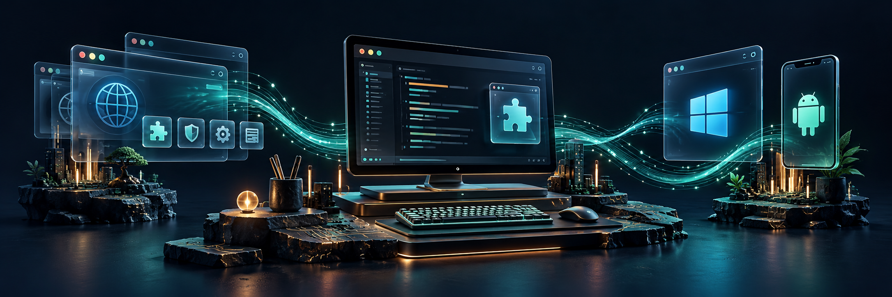

## ar.urusoff

**English** · [Русский](README.ru.md)

**Contact:** [ar.urusoff@gmail.com](mailto:ar.urusoff@gmail.com)

I build browser extensions and practical tools for Windows and Android. My projects focus on everyday tasks: making browsing more comfortable, exporting useful data, and managing connections.

### Projects

| Project | What it does |
| :--- | :--- |
| **[NightTime](https://github.com/urusoff16/NightTime)** | Dark mode, color profiles, and eye-comfort settings for websites. Smart Dark readability analysis is in development. |
| **[ScrollWizard](https://github.com/urusoff16/ScrollWizard)** | Customizable scrolling and mouse gestures for Chromium browsers. |
| **[AWG Pilot](https://github.com/urusoff16/awg-pilot)** | An AmneziaWG VPN client for Windows and Android. |
| **[Instagram Comment Parser](https://github.com/urusoff16/insta_comment_parser)** | Export Instagram comments and replies to CSV and Excel. |
| **[YouTube Comments Parser](https://github.com/urusoff16/YouTube_comments_parser)** | Export YouTube comments and work with threaded replies. |

### How I approach projects

- Clear, readable interfaces with a small number of useful controls.
- English and Russian localization.
- Iterative development, practical testing, and documented limitations.

**Languages in my public projects:** TypeScript · JavaScript · Go

For setup, releases, support, and license terms, see each project's repository.

[Browse all repositories →](https://github.com/urusoff16?tab=repositories)
