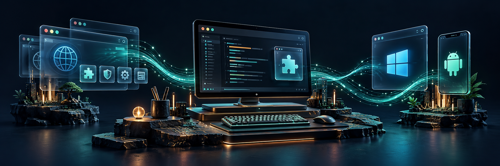

## ar.urusoff

[English](README.md) · **Русский**

**Связь:** [ar.urusoff@gmail.com](mailto:ar.urusoff@gmail.com)

Создаю расширения для браузера и полезные инструменты для Windows и Android. Мои проекты решают повседневные задачи: делают работу в браузере удобнее, помогают выгружать данные и управлять подключениями.

### Проекты

| Проект | Что делает |
| :--- | :--- |
| **[NightTime](https://github.com/urusoff16/NightTime)** | Тёмный режим, цветовые профили и комфортные настройки для сайтов. Анализ читаемости Smart Dark находится в разработке. |
| **[ScrollWizard](https://github.com/urusoff16/ScrollWizard)** | Настраиваемая прокрутка и жесты мышью для Chromium-браузеров. |
| **[AWG Pilot](https://github.com/urusoff16/awg-pilot)** | VPN-клиент AmneziaWG для Windows и Android. |
| **[Instagram Comment Parser](https://github.com/urusoff16/insta_comment_parser)** | Выгрузка комментариев и ответов Instagram в CSV и Excel. |
| **[YouTube Comments Parser](https://github.com/urusoff16/YouTube_comments_parser)** | Выгрузка комментариев YouTube и работа с ветками ответов. |

### Подход к работе

- Понятные, читабельные интерфейсы с небольшим количеством полезных элементов управления.
- Русская и английская локализация.
- Поэтапная разработка, практические проверки и описание ограничений.

**Языки публичных проектов:** TypeScript · JavaScript · Go

Установка, релизы, поддержка и условия лицензии описаны в репозитории каждого проекта.

[Все репозитории →](https://github.com/urusoff16?tab=repositories)
